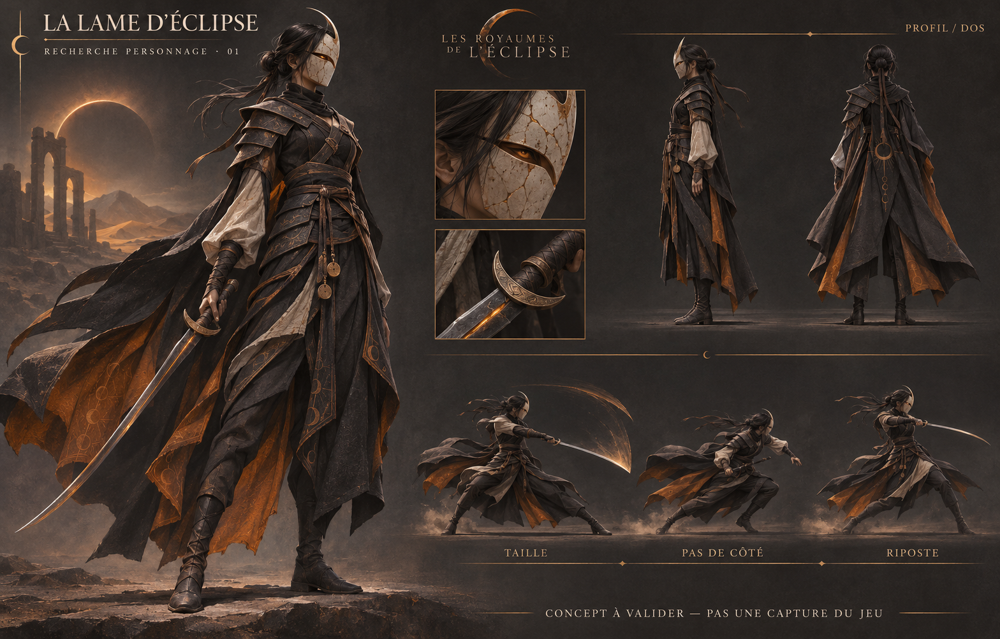

# La Lame d’Éclipse — recherche 01, à revoir avant production

État : **direction validée par l’utilisateur le 17 novembre 2026 ; première version 3D à revoir**. La planche est une illustration de recherche générée le 17 novembre 2026 ; elle n’est ni un modèle 3D ni une capture du jeu. Le nouveau modèle est produit pour cette seule classe, après validation de la planche. Il reste plus simple que l’illustration et n’est pas présenté comme une finition artistique acquise.

## Intention

Une ancienne gardienne des noms effacés, précise et patiente. Son corps porte le poids des décisions ; ses gestes doivent montrer maîtrise et engagement. La version proposée est une adulte élancée, avec un masque minéral et une silhouette asymétrique. La direction de la planche est approuvée ; les proportions et les détails de la construction 3D font l’objet de la revue suivante.

La direction noir/ambre est traitée par contraste de matières : manteau sombre usé, doublure chaude rare, métal noir et céramique claire. Le sabre est une arme physique, avec une ligne ambrée discrète, une garde compacte et une prise crédible. Le manteau est fendu pour laisser lire les appuis. Les petits jetons du costume peuvent évoquer les souvenirs conservés.

## Gestuelle propre au personnage

| Geste | Intention à concevoir et à animer |
|---|---|
| Garde | Lame basse, épaule libre détendue, regard dirigé vers la menace ; respiration subtile |
| Marche / course | Appuis souples, transfert du poids, départ et freinage en plusieurs poses ; bras libre pour l’équilibre |
| Pas latéraux / arrière | Clips dédiés gardant le torse orienté vers la menace ; transitions synchronisées avec les appuis |
| Taille du croissant | Coupe diagonale avec petit pas avant ; préparation, contact et sortie lisibles |
| Retour de braise | Coupe remontante inversée, rotation du bassin ; trajectoire et récupération différentes |
| Sentence | Préparation plus engagée, frappe descendante et récupération vulnérable |
| Esquive | Pas court de côté ; pieds visibles, inertie du manteau, reprise de garde |
| Riposte | Déviation courte puis réponse précise, en conservant une prise plausible |
| Traversée | Déplacement surnaturel bref, silhouette noire/ambre lisible, arrivée orientée et reprise d’appui |
| Blessure / interaction | Réactions proportionnées ; main libre utilisée pour toucher/lire plutôt que geste générique du fusil |

Ce tableau définit une intention artistique. Il ne décrit pas des clips déjà fabriqués ni un équilibrage validé. L’esquive et le pouvoir doivent être distingués dans leurs mouvements, leur distance, leurs effets et leurs retours sonores.

## Critères de revue

- Silhouette reconnaissable depuis la caméra de jeu et à petite taille.
- Masque, manteau, arme et proportions approuvés avant modelage détaillé.
- Appuis et gestes compréhensibles en image fixe, puis à vitesse normale.
- Cape qui complète la gestuelle sans masquer constamment les jambes ni traverser l’arme.
- Les vues profil/dos et les études de geste de la planche sont des références : les incohérences éventuelles seront résolues dans un turnaround de production.

## Après validation seulement

1. Turnaround de construction cohérent et modèle de référence Blender, UV/matières et rig adapté.
2. Export GLB portable ; garde, marche, arrêt et pivot revus dans la caméra du jeu.
3. Trois attaques, esquive et pouvoir conçus et revus séparément ; transitions et prises d’arme.
4. Intégration dans une salle de référence, contacts, effets, sons et tests sur appareil.
5. Revue du résultat jouable avant extension aux autres héros.

Le budget des meshes, matières, os, textures et ombres sera établi à partir des mesures de la scène et du téléphone cible. Une illustration détaillée ne garantit pas un rendu temps réel identique.

## Première production 3D

- Source éditable : `assets/source/lame-reference.blend`.
- Générateur dédié : `scripts/author_lame_reference.py` ; squelette compatible avec le jeu, surfaces de vêtement et atlas PBR intégrés au GLB.
- 23 clips : 13 actions compatibles, garde, départ/arrêt/pivots et études directionnelles/esquives. Trois trajectoires de sabre sont posées par une résolution des bras et des clés dédiées.
- Contrôleur du jeu : sélection des clips de la Lame, transitions et appuis existants conservés ; les dix autres héros gardent leurs modèles.
- Atelier : `docs/atelier-lame.html`, rotation du modèle et choix des gestes. La planche validée y reste distincte du rendu réel.

La modélisation de la coiffure, la finesse des drapés et des matériaux, les déformations et les transitions restent à retravailler. Il n’y a pas de simulation physique complète du tissu ni de capture de mouvement.
